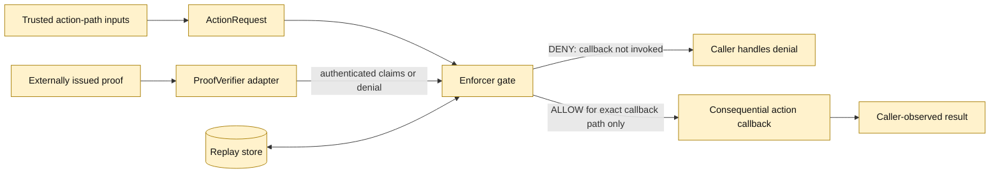

# Architecture and status

## Current status

**Prototype only.** This code provides one narrow mechanism for experimenting with action-bound authorization. It does not implement the complete One Ring design and is not evidence that the Constitution is operational.

## Trust boundaries

All diagram elements above are intended interfaces in this prototype. The diagram is **not** a source-verified connection to any existing ≡TACK repository or production action consumer.

## Call flow

1. The caller resolves the subject, operation, target, and unique request ID from its trusted context.
2. An external authority issues a grant; issuance is outside this package.
3. The configured `ProofVerifier` authenticates the grant and trusted issuer, then returns `GrantClaims`.
4. Enforcer checks exact subject/action/target/request binding and time bounds.
5. The replay store atomically consumes `(issuer_id, nonce)` and the unique `request_id`.
6. Only then does `execute` invoke the supplied callback.
7. The caller remains responsible for recording the actual action result and connecting it to independent review.

## Design limits / unresolved choices

- No production verifier, key format, identity provider, issuer registry, revocation mechanism, or trust-anchor governance is selected.
- The default SQLite store is in-memory and loses replay history on process exit; a file-backed instance persists locally. Neither local mode coordinates replay protection across hosts.
- Replay records are not currently pruned. Retention and cleanup require a policy that does not allow any valid grant to become reusable.
- This library cannot prevent callers from invoking the same action through an unguarded alternate path.
- The current `Decision` is a local function result, not an independently signed, tamper-evident event ledger.
- No constitutional amendment workflow or protected-change mechanism exists here.
- The One Ring investigation must compare this capability with existing repositories before deciding to retain it.
